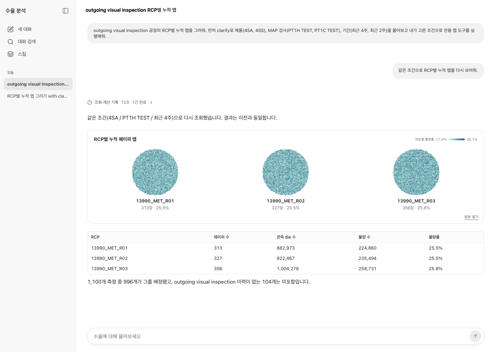

# 반입 전 검증 기록

## 2026-11-24 채팅별 Python 변수와 웨이퍼 맵 엑셀 다운로드

앱 기준 커밋 `9733331f`, Hermes 원본 `5894e750`, 모델 OpenRouter `z-ai/glm-5.3-flash`로 검증했다. 검증용 개발 웹 서버에서 새 채팅을 열어 다음 결과를 확인했다.

| 실제 채팅에서 수행한 작업 | 확인 결과 |
|---|---|
| 첫 질문에서 변수 `wafer_stamp`에 무작위 24바이트를 저장하고 해시만 표시한 뒤, 다음 질문에서 변수 원값을 읽었다. | 실행 횟수가 1에서 2로 올라갔고 두 번째 호출은 같은 Python 세션을 재사용했다. 읽은 값의 SHA-256이 첫 질문의 해시와 일치했다. |
| 같은 채팅에서 4SS038N LOT의 8번 웨이퍼 PT1H TEST 맵을 조회하고, 맵과 좌표를 엑셀로 요청했다. | 같은 화면에서 엑셀을 다시 요청해 새로고침 없이 다운로드 버튼을 눌렀다. 받은 파일 `PT1H_confirmed.xlsx`는 127,568바이트였다. |
| 다운로드한 엑셀을 열고 개발 Oracle을 독립 조회했다. | ‘맵’ 시트에 이미지 1장(1,339 × 1,179픽셀), ‘좌표’ 시트에 데이터 2,821행이 있었다. 모든 좌표와 좌우 BIN이 DB와 같았다. 맵의 통과 2,003개, 불량 818개, 빈 위치 900개도 일치했다. |

선별한 백엔드 회귀 검사 71건과 웹 화면 검사 12건이 통과했고 프론트 빌드도 성공했다. macOS 전체 하네스 테스트는 변경 전 기준 코드에서 1,888건 통과·71건 실패·1건 건너뜀, 변경 후 1,907건 통과·69건 실패·1건 건너뜀이었다. 검사 ID를 대조한 결과 새로 실패한 검사는 없었다. 아래의 과거 개발 작업본과는 소스 범위가 다르다. Ubuntu 직원별 파일 격리 검사는 배포 전에 실제 서비스 계정으로 실행해야 한다. [사내 재현 절차](04-acceptance.md#web-python-delivery) · [Ubuntu 통과 기준](04-acceptance.md#ubuntu-배포-전-직원별-파일-격리)

## 2026-11-24 하네스 검증

macOS 개발 작업본에서 하네스 전체 테스트를 실행했다. **1,869건 통과, 0건 실패, 1건 건너뜀**이었고 실행 시간은 295.86초였다. 이전에 개별 설정이 필요했던 15건(직원별 파일·분석 환경 11건, 고정 Hermes 원본 대조 3건, MongoDB 대화 이력 1건)이 기본 설정으로 실행됐다. 이 수치는 당시 개발 작업본 기준이며, 별도 작업 중이던 첨부파일 전송과 채팅별 Python 상태 유지 검사도 포함한다. [macOS 재실행 방법](../../08-YieldAgent/harness/README.md#macos에서-전체-하네스-테스트-실행)

이식 기준 커밋 `725e4433`의 깨끗한 복사본에서도 macOS 파일 격리, 게이트웨이 명세, MongoDB 이력과 Linux 격리 검사를 선별해 실행했다. **35건 통과, Linux 전용 1건 건너뜀**이었다. 위 개발 작업본의 첨부파일 전송·채팅별 Python 상태 유지 검사 2건은 이 커밋에 포함되지 않는다. 이식 목록의 파일 4,854개는 모두 이 커밋의 내용과 실행 권한이 일치했다.

**Ubuntu 직원별 파일 격리 1건은 배포 전 필수 · 미검증이다.** macOS에서는 Linux 사용자·네트워크 네임스페이스를 사용할 수 없어 이 검사만 건너뛰었다. 실제 Ubuntu 서비스 계정으로 직원 A가 자기 CSV를 읽을 수 있고 직원 B의 접근은 거부되는지 확인하고, 실행 결과를 사내 배포 기록에 남긴다. [검증 명령과 통과 기준](04-acceptance.md#ubuntu-배포-전-직원별-파일-격리)

## 공용 입력과 채팅별 표·맵

앱 커밋 `40985fff` 기준으로 개발 환경의 OpenRouter `z-ai/glm-5.3-flash` 요청에서 파일 읽기·검색, 이미지 분석, 작업 위임을 확인했다. 할 일 목록은 원본 자동 검색 목록에 있었다.

같은 계정의 새 채팅 두 개가 같은 CSV를 읽어 각각 표 1개와 맵 1개를 표시했다. 두 화면의 PT1H 수율은 71.0%였고, 두 맵 모두 개발 Oracle의 2,821개 좌표 및 통과·불량 판정과 일치했다. 표 데이터 16개와 맵 2개의 주소는 원래 세션에서 200, 상대 세션 ID로 요청하면 404였다. 공용 폴더 밖 파일 읽기는 차단됐다. 별도 후속 질문에서 이미지 도구가 공용 PNG의 초록 원 1개와 빨간 직사각형 3개를 식별했다.

세션 이력 회귀 검사는 실제 Hermes 세션 DB를 닫고 다시 열어 다른 대화의 메시지가 섞이지 않는지 확인한다. 실제 워커를 구동하는 검사에서는 엔진 커밋, 이력 출처와 후속 요청의 모델 입력을 확인했다. 관련 회귀 검사 52개가 통과했다.

## 원본 자동 검색과 공정명 조회

이전 검증의 앱 기준 커밋은 `b2886232`다. `158babfc`에서 일반 웹 채팅의 자동 검색을 Hermes 기본값으로 복원했고, `b2886232`에서 맵 도구와 제조 공정명 인자의 설명을 갱신했다. 개발 웹 채팅에서 OpenRouter `z-ai/glm-5.3-flash`와 Oracle로 다음 동작을 확인했다.

| 확인 항목 | 개발 환경 관찰값 |
|---|---|
| 도구 노출과 권한 | 기본 권한의 첫 요청에 직접 보이는 도구가 12개에서 8개로 바뀌었다. 8개는 조건 선택, 메모리, 스킬 도구 3개, 자동 검색 도구 3개다. 두 직원으로 대화를 검색했을 때 각자 본인의 대화만 조회됐다. |
| 정확한 공정명 | 4SA·PT1H TEST·최근 4주에서 `outgoing visual inspection`으로 조회했다. 최종 설명 적용 후 한 실행에서 조건 선택 → 도구 설명 확인 → 맵 실행까지 모델이 도구를 3회 호출했고 공정 목록 조회는 0회였다. RCP별 313·327·356장과 미배정 104건이 DB와 일치했다. |
| 오타 | `inspecton`은 GLM이 맵 호출 전에 스스로 고쳤다. `inspections`는 첫 맵에서 실패한 뒤 DB 공정 목록에서 단수형을 찾아 같은 맵을 표시했다. 도구 설명은 조회 순서를 안내하며 모델이 입력할 철자를 강제하지 않는다. |
| 스킬 저장 | 빈 프로필에서 동일한 복수형 질문을 웹과 원본 직접 실행 각각 3회 반복했다. 맵은 여섯 번 모두 DB와 일치했다. 웹 1회에서만 스킬을 저장했고, 이때 원본의 60자 제한으로 세 번 거절된 뒤 성공했다. 원본 직접 실행의 비교 3회는 저장 없이 끝났다. |

## GLM으로 검증한 RCP별 누적 맵과 후속 질문

2026-11-23에 앱 커밋 `cdcc284f`의 웹 채팅과 고정 Hermes 원본(`5894e750`) 직접 실행을 개발용 Oracle 더미 DB에서 대조했다. 두 경로 모두 실제 요청의 모델 ID는 OpenRouter의 `z-ai/glm-5.3-flash`였다.

1. 새 채팅에서 “outgoing visual inspection 공정의 RCP별 누적 맵을 그려줘”라고 요청하면서 제품·검사·기간을 먼저 물어보도록 했다. **4SA → PT1H TEST → 최근 4주**를 선택했다.
2. 같은 채팅에서 **“같은 조건으로 RCP별 누적 맵을 다시 보여줘.”**라고 보냈다. 웹과 원본 모두 후속 질문의 모델 입력에 앞서 선택한 세 값이 들어 있었다.
3. 각 경로에서 첫 질문과 후속 질문에 `load_wafer_maps`가 한 번씩 실행됐다. 네 호출 모두 모델이 작성한 인자와 실제 도구가 받은 인자가 일치했다. 공통 인자는 `lot_cd="4SA"`, `oper="PT1H TEST"`, `recent_weeks=4`, `aggregate.group_by="recipe"`였다. `aggregate.group_oper`에는 웹이 소문자로, 직접 실행이 대문자로 같은 공정명을 전달했다.

| RCP | 웹 첫 질문 | 웹 후속 질문 | Hermes 직접 실행 두 턴 각각 | 독립 Oracle 조회 |
|---|---:|---:|---:|---:|
| 13990_MET_R01 | 313장 | 313장 | 313장 | 313장 |
| 13990_MET_R02 | 327장 | 327장 | 327장 | 327장 |
| 13990_MET_R03 | 356장 | 356장 | 356장 | 356장 |

측정 1,100건 중 996건이 세 RCP에 배정됐다. 해당 공정 이력이 없는 104건은 미배정으로 집계됐고, 여러 RCP가 일치한 건은 0건이었다. 웹의 두 답변에서 맵 세 개와 표를 확인했다. 사내 검수에서는 같은 절차로 해당 DB의 실측값을 구한다.

## Ubuntu 로컬 실행 변경

앱 커밋 `77c9c75f`에서 갱신한 FILES.tsv의 4,853개 항목을 Git 원본과 대조했다. 기존 목록과의 차이는 두 백엔드 커밋에서 변경·추가한 20개 파일과 일치했다. Hermes 원본 2,656개 파일도 기존 매니페스트와 일치했다.

Ubuntu 24.04.5 LTS(커널 6.8) 시험 서버에서 SSH 서버와 전용 계정 없이 일반 계정으로 실행했다. 별도 backend 설정 없이 `local`을 선택하고 실제 `bwrap` 검사를 통과했다. 두 사용자의 CSV를 각각 저장한 뒤 생성 Python이 자기 CSV의 41을 읽어 42를 반환하고, 다른 사용자의 CSV에 접근할 수 없음을 확인했다. 이어서 실행 작업 폴더의 파일 정리도 확인했다.

macOS 개발 채팅에서 실제 모델이 run_python을 호출해 1부터 10까지의 합 55를 반환했다. 별도 로컬 검증에서 개발 Oracle 조회 결과가 CSV와 Python 계산에 그대로 전달됨을 독립 SQL 결과와 대조했다. 사내 배포 검증은 04의 절차로 내부에서 실시한다.

## 기존 앱 체크포인트 검증

소스 기준 `58ad8ee71f113edcbab4c471dc0aac25f0330cd2`. 검증 호스트는 macOS Apple Silicon이다. 다음 결과는 외부 개발용 더미 환경에서 얻었다. 사내 레포와의 실제 병합 및 사내 DB 결과는 내부 담당자가 04에 기록한다.

| 항목 | 실제 실행 및 결과 |
|---|---|
| 소스 범위 | Git 객체로 아카이브를 두 번 만들어 바이트 일치. harness 2,890개, harness_console 1,934개, 공용·루트 및 기타 경로 28개. 총 4,852개, 원본 크기 합계 73,797,160바이트. required 4,014, test 811, optional 15, docs 12 |
| 마지막 변경 | 기준 커밋과 직전 커밋의 경로 차이는 144개. 추가 42, 수정 96, 삭제 6. 현재 반입 파일에 포함되는지 CHECKPOINT-144.tsv에 표시 |
| 원본 무결성 | 기준 Git 트리의 선별 경로·바이트·실행 비트를 FILES.tsv와 대조. 엔진 매니페스트 2,656개 해시 확인 |
| 사내 병합 도우미 | 임시 git 레포에 서로 다른 common.py를 둠. 충돌까지 ADD를 지정했을 때 쓰기 전 중단. MERGE로 남기고 나머지 4,851개 파일을 ADD한 뒤 모든 바이트·실행 비트 일치, 기존 common.py 보존. 재실행으로 추가한 파일 0개 |
| 소스만 풀어 기동·빌드 | 새 venv에 uv 잠금 버전 273패키지 설치, bundled Hermes import 성공. 대표 백엔드 테스트 47개·프론트 테스트 39개 통과. npm 잠금 설치 후 TypeScript/Vite production build 성공 |
| 실제 DB 리포트 | 추출본에서 개발 Oracle 연결만 주입하고 ReportAnalysis(months=3, weeks=4, days=3, parameters_per_direction=3, bins_per_test=10) 경로 실행. 4SA에서 success, 월 3/주 4/일 3 버킷, 열화·개선 순위 6개/산점도 원자료 2,400점, PT1H TEST·PT1C TEST 주차별 BIN/델타맵 산출물 각 1개. 표 3개·산점도 1개·검사별 맵 2개 합계 6개. 사내 DB 값 또는 새 반입본의 브라우저 실측으로 간주하지 않음 |
| 같은 커밋의 실제 채팅 | 이전 별도 체크아웃에서 실제 브라우저→모델→네이티브 list_tables/query_db/read_result→새 채팅 완료. 개발 Oracle 독립 집계와 4SA 190 LOT/3,950장, 4SS 187 LOT/3,950장 일치. 기존 체크아웃에서는 별도 선택 백엔드 테스트 49개와 프론트 테스트 39개 통과. 위 추출본 테스트와 중복 집계하지 않음 |
| 프로필·메모 | 원본 업무 SKILL.md 4개와 동봉본 바이트 일치. 빈 프로필에서 Hermes 카탈로그가 4개 활성 상태로 읽음. 기본 설치·더미 메모 선택 설치·재실행·목적지 충돌 검사, 하위 리소스와 SQLite WAL 포함 스냅숏/무결성 검사 통과 |
| 저장소 계약 | 개발 Oracle에 읽기 전용, 9개 테이블/뷰의 0행 조회 통과. 분리한 시험 MongoDB에 데이터를 만들어 mongodump와 mongorestore 실행 후 GridFS 원본 ObjectId·파일 바이트 일치. 실제 과거 사용자 DB 전체를 반입한 시험은 수행하지 않음 |
